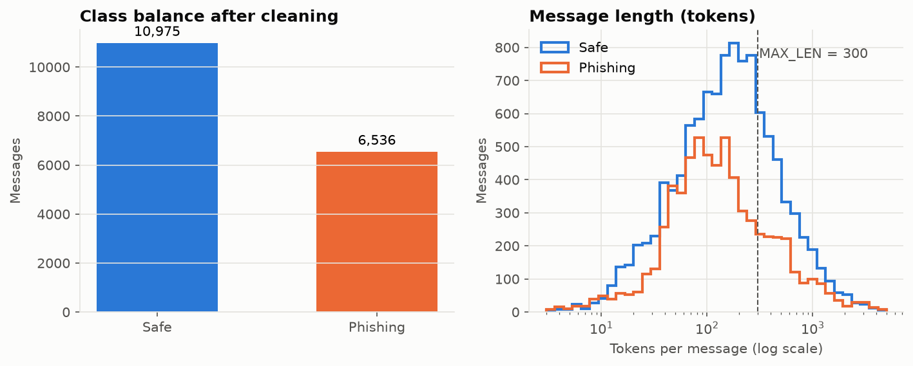
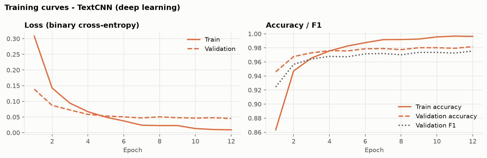
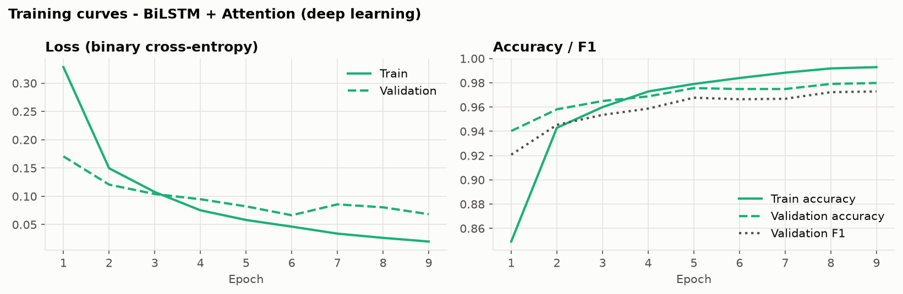
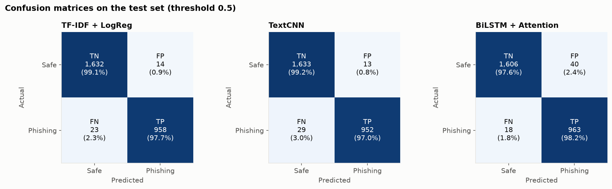
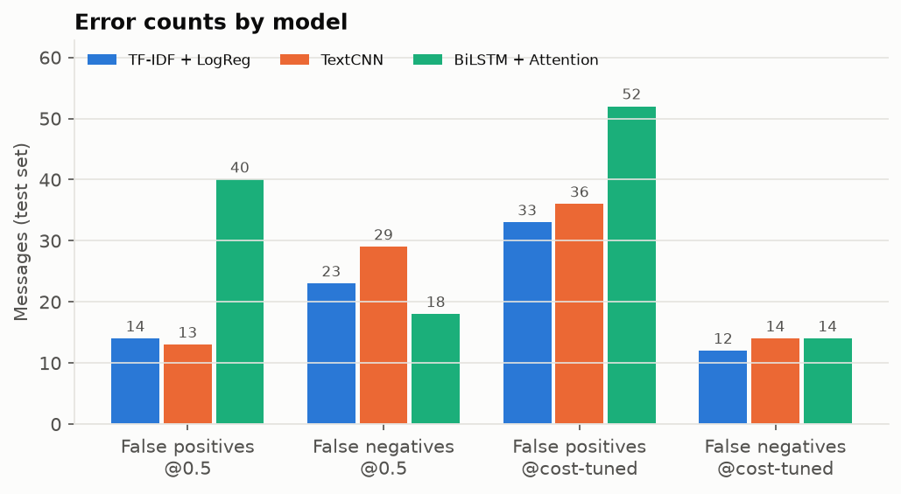
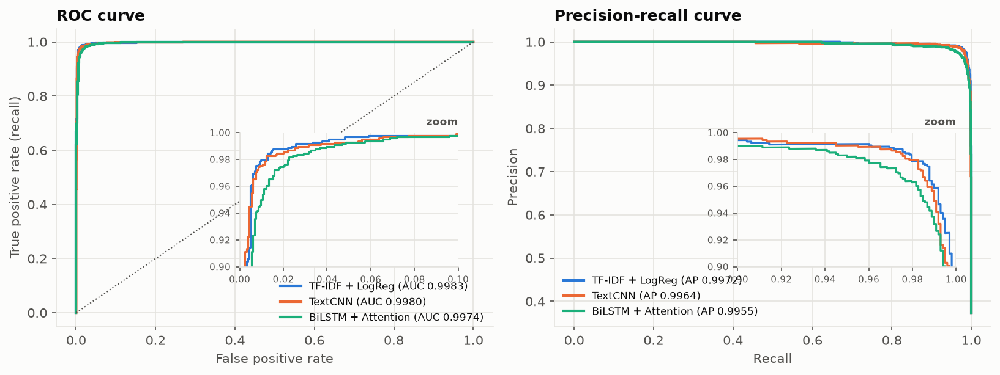
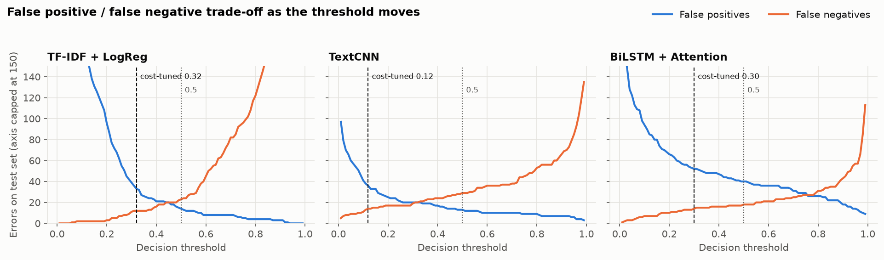
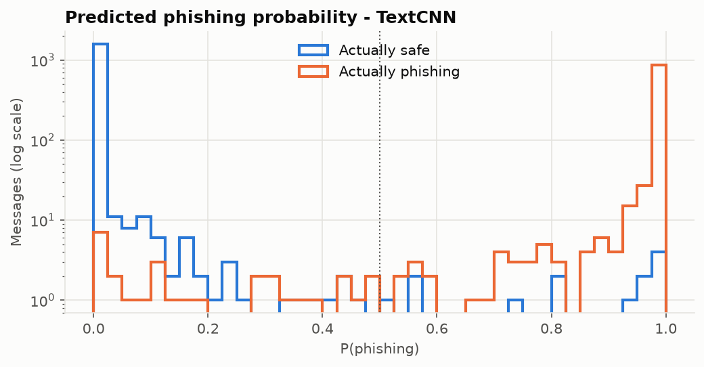

# Phishing Message Detection with Deep Learning

**Course project — Artificial Intelligence**

> **Task.** Train a text classification model on labelled sample messages to
> identify likely phishing messages. Evaluate false positives and false negatives.

---

## 1. Introduction

Phishing messages try to trick people into revealing passwords, bank details or
money by pretending to come from a trusted source. Rule-based filters
(blocklists, keyword rules) are easy to evade, so modern filters *learn* what
phishing looks like from labelled examples.

We treat the problem as **binary text classification**:

| Label | Meaning |
|---|---|
| `1` – phishing | malicious / fraudulent message |
| `0` – safe | legitimate message |

We train two **deep learning** models — a convolutional network (TextCNN) and a
recurrent network with attention (BiLSTM + Attention) — and compare them with a
classical machine-learning baseline (TF-IDF + Logistic Regression). The main
part of the evaluation is the analysis of the two kinds of error:

* **False positive (FP)** — a *safe* message is flagged as phishing. Users lose
  legitimate mail and stop trusting the filter.
* **False negative (FN)** — a *phishing* message gets through. The user may be
  defrauded or have their account compromised.

## 2. Dataset

**Source:** [Phishing Email Dataset](https://huggingface.co/datasets/zefang-liu/phishing-email-dataset)
— 18,650 emails labelled `Safe Email` or `Phishing Email` (a mix of Enron
corporate mail, mailing lists and spam/phishing corpora).

### 2.1 Cleaning (`src/data_prep.py`)

| Step | Messages left |
|---|---|
| Raw file | 18,650 |
| Remove missing / empty / literal `"empty"` text | 18,098 |
| Remove **exact duplicates** | 17,521 |
| Remove messages with fewer than 3 tokens | **17,511** |

Removing duplicates matters. Without it, the same message can end up in both
the training and test sets, which inflates the test score (*data leakage*).

Final class balance: **10,975 safe (62.7%)** and **6,536 phishing (37.3%)**.



The median message is about 160 tokens, but the length distribution has a
very long tail. Deep models keep the first **300 tokens** (`MAX_LEN`), which
covers the whole message for about 75% of emails.

### 2.2 Train / validation / test split

A stratified 70 / 15 / 15 split (every split keeps 37.3% phishing):

| Split | Messages | Used for |
|---|---|---|
| Train | 12,257 | learning model weights and the vocabulary |
| Validation | 2,627 | early stopping, choosing the decision threshold |
| Test | 2,627 (1,646 safe / 981 phishing) | **final evaluation only — used once** |

### 2.3 Text preprocessing (`src/text_utils.py`)

1. Lower-case everything.
2. Replace patterns with placeholder tokens so the model learns *that* a link,
   address or amount is present rather than memorising specific ones:
   URLs → `urltoken`, e-mail addresses → `emailtoken`, money (`$1,000`) →
   `moneytoken`, numbers → `numtoken`.
3. Tokenise into words, keeping `! ? $ %` as tokens, because urgency and money
   symbols are typical of phishing.
4. Build a vocabulary from the **training split only** (tokens seen ≥ 2 times,
   at most 30,000) → 30,002 entries including `<pad>` and `<unk>`.

## 3. Models

### 3.1 Baseline — TF-IDF + Logistic Regression (`src/baseline.py`)

Each message becomes a sparse vector of TF-IDF weights over unigrams and bigrams
(up to 60k features); a logistic regression then learns one weight per feature.
It is fast, interpretable and a strong reference point for text classification.

### 3.2 TextCNN (`src/models.py`)

```
tokens → Embedding(30,002 × 128)
       → 3 parallel Conv1D (128 filters each, window 3 / 4 / 5 words) + ReLU
       → max-over-time pooling → concat (384) → Dropout(0.5) → Linear → sigmoid
```

Each convolution filter acts as a learned **n-gram detector** (e.g. *"verify
your account"*, *"click here"*). Max-pooling keeps the strongest match
anywhere in the message. 4.04M trainable parameters.

### 3.3 BiLSTM + Attention (`src/models.py`)

```
tokens → Embedding(30,002 × 128) → Dropout
       → Bidirectional LSTM (128 per direction, packed sequences)
       → additive attention over time steps → weighted sum (256)
       → Dropout(0.4) → Linear → sigmoid
```

The LSTM reads the message left-to-right and right-to-left, so each word's
representation includes its context. The **attention layer** learns how much
each word contributes to the decision, and those weights are used to *explain*
predictions (Section 6.4). 4.10M trainable parameters.

### 3.4 Training setup (`src/train.py`)

| Setting | Value |
|---|---|
| Loss | Binary cross-entropy with logits |
| Optimiser | AdamW, lr = 1e-3, weight decay = 1e-5 |
| LR schedule | ReduceLROnPlateau (×0.5 after 1 epoch without improvement) |
| Batch size | 64 |
| Regularisation | Dropout, gradient clipping (norm 5) |
| Early stopping | stop after 3 epochs without lower validation loss; keep the best checkpoint |
| Max epochs | 12 |
| Hardware | CPU only (TextCNN ≈ 20 s/epoch, BiLSTM ≈ 4 min/epoch) |
| Seed | 42 |




The **TextCNN** improved steadily for all 12 epochs (best validation loss 0.0455
at epoch 12). The **BiLSTM** reached its best validation loss (0.0665) at epoch 6;
its validation loss then fluctuated while training loss kept falling — a sign of
**overfitting** — so early stopping ended training at epoch 9 and restored the
epoch-6 weights.

## 4. Evaluation method (`src/evaluate.py`)

All numbers below are on the **held-out test set** (2,627 messages), which no
model saw during training or tuning.

| Metric | Meaning in this project |
|---|---|
| Precision | Of the messages flagged as phishing, how many really were phishing |
| Recall (TPR) | Of the real phishing messages, how many were caught |
| F1 | Harmonic mean of precision and recall |
| **FPR** = FP / (FP + TN) | Share of safe messages wrongly flagged |
| **FNR** = FN / (FN + TP) | Share of phishing messages missed |
| ROC-AUC, PR-AUC | Ranking quality across *all* thresholds |
| MCC | Balanced single-number score (robust to class imbalance) |

**Two operating points** are reported:

1. **Default threshold 0.5** — predict phishing if P(phishing) ≥ 0.5.
2. **Cost-tuned threshold** — we assume a missed phishing message (FN) is
   **3× as costly** as a false alarm (FP) and pick the threshold that minimises
   `3·FN + 1·FP` **on the validation set**, then apply it unchanged to the test set.

We also report an **ensemble** that averages the three models' probabilities.

## 5. Results

### 5.1 Default threshold (0.5)

| Model | Accuracy | Precision | Recall | F1 | ROC-AUC | PR-AUC | MCC | **FP** | **FN** | FPR | FNR |
|---|---|---|---|---|---|---|---|---|---|---|---|
| TF-IDF + LogReg (baseline) | 98.59% | 98.56% | 97.66% | 0.9811 | 0.9983 | 0.9972 | 0.9699 | 14 | 23 | 0.85% | 2.34% |
| TextCNN | 98.40% | **98.65%** | 97.04% | 0.9784 | 0.9980 | 0.9964 | 0.9658 | **13** | 29 | **0.79%** | 2.96% |
| BiLSTM + Attention | 97.79% | 96.01% | 98.17% | 0.9708 | 0.9974 | 0.9955 | 0.9532 | 40 | 18 | 2.43% | 1.83% |
| **Ensemble (average)** | **98.71%** | 98.17% | **98.37%** | **0.9827** | **0.9985** | **0.9975** | **0.9724** | 18 | **16** | 1.09% | **1.63%** |



### 5.2 Cost-tuned threshold (FN cost = 3 × FP cost, tuned on validation)

| Model | Threshold | Precision | Recall | F1 | **FP** | **FN** | FPR | FNR |
|---|---|---|---|---|---|---|---|---|
| TF-IDF + LogReg | 0.32 | 96.71% | 98.78% | 0.9773 | 33 | 12 | 2.00% | 1.22% |
| TextCNN | 0.12 | 96.41% | 98.57% | 0.9748 | 36 | 14 | 2.19% | 1.43% |
| BiLSTM + Attention | 0.30 | 94.90% | 98.57% | 0.9670 | 52 | 14 | 3.16% | 1.43% |
| **Ensemble** | 0.21 | 94.75% | **99.29%** | 0.9696 | 54 | **7** | 3.28% | **0.71%** |



### 5.3 ROC and precision-recall curves



All three models have ROC-AUC above 0.997: they rank almost every phishing
message above almost every safe one. The differences are in the top-left corner
(see zoomed insets), i.e. in the handful of hard messages.

### 5.4 Example predictions on new, hand-written messages (`python src/predict.py --demo`)

Eight messages written for this project (not in the dataset), four phishing and four safe:

| Message (shortened) | True | Baseline | TextCNN | BiLSTM (P) and top attention words |
|---|---|---|---|---|
| "unusual activity… access suspended. Click here http://… to verify" | phishing | ✔ | ✔ | ✔ 1.00 — *click, suspended, account* |
| "selected to receive a $1,000 gift card… credit card number" | phishing | ✔ | ✔ | ✔ 0.99 — *claim, card, !, shipping* |
| "URGENT: mailbox exceeded storage limit. Login at www.mail-upgrade.net…" | phishing | ✔ | ✘ | **✘ 0.25** — *login, exceeded, limit, storage* |
| "lawyer… estate… $15.5 million… reply with your bank details" | phishing | ✔ | ✔ | ✔ 0.99 — *funds, bank, reply, transfer* |
| four ordinary work / academic emails | safe | ✔ ✔ ✔ ✔ | ✔ ✔ ✔ ✔ | ✔ ✔ ✔ ✔ (all ≤ 0.005) |

## 6. False positive and false negative analysis

Misclassified test messages are saved to `results/errors/<model>_false_positives.csv`
and `..._false_negatives.csv`, sorted by how confident the wrong prediction was.

### 6.1 The FP / FN trade-off is controlled by the threshold



FPs and FNs pull in opposite directions. Lowering the threshold catches more
phishing (fewer FN) but flags more legitimate mail (more FP):

* With the ensemble, moving from 0.5 to 0.21 cuts missed phishing from
  **16 → 7** (−56%) but raises false alarms from **18 → 54** (×3).
* The "right" threshold is a **business decision**, not a modelling one. A
  bank's security team might accept 3% false alarms to miss <1% of phishing;
  a personal mail client might prefer the reverse. Because the threshold is
  chosen on validation data, the test result is a fair estimate.

The deep models are **more confident** than the baseline (their probabilities
pile up near 0 and 1), so their cost-tuned thresholds move further from 0.5
(TextCNN: 0.12):



### 6.2 What do the errors look like?

Profile of errors at threshold 0.5 (from `results/results_summary.md`):

| Model | Group | Count | Median length (tokens) | Contains a URL | Mean confidence of the prediction* |
|---|---|---|---|---|---|
| Baseline | False positives | 14 | 134 | 14% | 0.41 |
| Baseline | False negatives | 23 | 155 | 13% | 0.36 |
| TextCNN | False positives | 13 | 203 | 8% | 0.66 |
| TextCNN | False negatives | 29 | 97 | 7% | 0.61 |
| BiLSTM | False positives | 40 | 188 | 23% | 0.68 |
| BiLSTM | False negatives | 18 | 100 | 11% | 0.62 |

\* `|2·P − 1|`: 0 = unsure, 1 = completely sure.

Error rate by message length:

| Length (tokens) | Messages | Baseline | TextCNN | BiLSTM |
|---|---|---|---|---|
| < 30 | 207 | 3.38% | 3.38% | **4.83%** |
| 30 – 100 | 750 | 1.33% | 1.47% | 2.00% |
| 100 – 300 | 985 | 1.12% | 1.22% | 1.83% |
| 300 – 1000 | 547 | 1.65% | 1.83% | 2.01% |
| > 1000 | 138 | 0.00% | 1.45% | 2.90% |

Observations:

* **Short messages are hardest** for every model: a 15-word message has too little
  evidence to go on.
* The **deep models' errors are more confident** (0.6–0.7) than the baseline's
  (≈0.4). When a deep model is wrong, it is often *sure* it is right, which
  is dangerous because confidence cannot be used to send uncertain cases to a human.
* **Very long messages** (>1000 tokens) are handled perfectly by the baseline
  but not by the deep models, which only see the first 300 tokens.

### 6.3 Errors that all models make (17 messages)

17 test messages are misclassified by **every** model. Reading them shows four
distinct causes:

**False positives — legitimate mail that "looks like" phishing**

| P(phishing) | Message (start) |
|---|---|
| 1.00 | *order confirmation 11871528 – thank you for shopping at radioshack.com… pending credit card approval* |
| 1.00 | *thank you for using register.com dear louise… a host of helpful tools…* |
| 1.00 | *welcome to energy news live dear vincent… you are receiving this email as a result of your registration* |
| 1.00 | *special delivery… you have been sent a virtual ice cream cone… visit the pick-up window at http://…* |
| 0.98 | *the sale of the rig closed and funded. we received our net $4.4 million.* |

→ **Cause 1: legitimate commercial / transactional email.** Order confirmations,
sign-up notices and newsletters use exactly the vocabulary of phishing ("thank
you for your order", "credit card", "click", money amounts, links). **Text
alone cannot separate them**; a real filter would also check the sender's
domain, SPF/DKIM authentication and where the links actually point.

**False negatives — phishing-labelled messages the models let through**

| P(phishing) | Message (start) | Comment |
|---|---|---|
| 0.01 | *junk mail: books for linguists — plurabelle books has a new catalogue…* | Ordinary spam / advertising |
| 0.03 | *Industrial LINUX News: The June issue of InTech Magazine…* | Newsletter |
| 0.08 | *FORD SALUTES THE MILITARY. THIS OFFER IS EXTENDED EXCLUSIVELY…* | Advertising |
| 0.00 | *why i love unverifiable voting machines, by the prez…* | Political satire |
| 0.25 | *Could you please send the address of your agent in Saudi Arabia. Thanks Sathar* | 14 words; label is doubtful |
| 0.17 | *let's get this settled hey, what's up. here's the link that you requested…* | **Real social-engineering lure** |

→ **Cause 2: label noise / broad label definition.** The dataset's "phishing"
class also contains plain **spam and newsletters** with no credential theft
or fraud. Neither the models nor a human would call some of these "phishing";
a few may simply be mislabelled.

→ **Cause 3: too little text.** Very short messages give no evidence either way.

→ **Cause 4: casual, personal-sounding lures.** *"here's the link that you
requested"* imitates a friend and contains none of the usual alarm words. This
is the most worrying kind of FN, because attackers can deliberately write in
this style.

### 6.4 What the BiLSTM pays attention to

The attention weights show which words drove each decision. For the correct
demo predictions the attended words make sense (*click, suspended, account*;
*funds, bank, transfer*). Across the BiLSTM's **40 false positives**, the most
attended tokens were:

`<unk>` (26), `numtoken` (13), `your` (11), `this` (10), `urltoken` (8),
`please` (6), `!` (4), `click` (3), `reply` (3)

The model has learned that **unknown (out-of-vocabulary) words signal
phishing**, because spammers misspell and obfuscate words ("v1agra", "c1ick").
Legitimate business mail is also full of rare words (people's names, project
codes, company names), and those are what trigger most of its false alarms.
This explains why the BiLSTM has about 3× more FPs than the other models.
Fixes: sub-word tokenisation (BPE/WordPiece) so rare words are not all
collapsed to one `<unk>`, or replacing `<unk>` with a character-level encoding.

### 6.5 Out-of-distribution false negative

The demo message *"URGENT: Your mailbox has exceeded its storage limit. Login
at www.mail-upgrade.net with your username and password"* is a textbook modern
credential-harvesting attack, yet both deep models let it through (BiLSTM
P = 0.25), even though the BiLSTM *did* attend to the right words (*login,
exceeded, limit, storage*). The training data is dominated by early-2000s
spam (pills, stock tips, "419" advance-fee scams), so this phrasing is rare in
it. **A model is only as current as its training data**, and phishing
campaigns change constantly.

## 7. Discussion

**Did deep learning beat the classical baseline?** Not on its own. On this
dataset TF-IDF + Logistic Regression is extremely strong (F1 0.981). TextCNN is
within 0.3 percentage points and has the fewest false positives; the BiLSTM
trades more false positives for fewer false negatives. Reasons:

1. **The task is largely lexical.** Phishing and spam are identified mainly by
   characteristic words and phrases, which bag-of-n-grams already captures.
   Word-order modelling (the LSTM's strength) adds little here.
2. **Data size.** 12k training messages is small for training 4M-parameter
   networks from scratch, with no pre-trained word embeddings. The BiLSTM
   overfitted after 6 epochs.
3. **Truncation.** Deep models see only the first 300 tokens.

**The best result comes from combining them.** The ensemble has the best F1
(0.9827), MCC, ROC-AUC and FNR at threshold 0.5. The models make *different*
mistakes (only 17 errors are shared out of 37–58 per model), so averaging their
probabilities cancels out part of each model's errors.

**Recommended configuration:** the **ensemble**. Use threshold 0.5 if false
alarms are expensive (1.1% FPR, 1.6% FNR), or the cost-tuned 0.21 if missing
phishing is unacceptable (99.3% recall, 0.7% FNR, at 3.3% FPR).

## 8. Limitations and future work

* **Pre-trained transformers.** Fine-tuning DistilBERT / RoBERTa would bring
  language knowledge learned from billions of words and handles rare words with
  sub-word tokens; this typically gives the largest gain on small datasets
  (needs a GPU for reasonable training time).
* **Use more than the text.** Real phishing filters use sender domain,
  authentication headers (SPF/DKIM/DMARC), link targets vs. displayed text,
  domain age and attachments. Many of our FPs (order confirmations) would be
  resolved by checking that the sender really is radioshack.com.
* **Better and newer labels.** Separate *phishing* from generic *spam*, fix
  noisy labels, and add recent phishing (SMS "smishing", fake delivery
  notices, MFA-fatigue lures) to address the out-of-distribution FN in §6.5.
* **Adversarial robustness.** Attackers adapt; test against paraphrased and
  obfuscated phishing.
* **Calibration.** Deep-model probabilities are over-confident (§6.2);
  temperature scaling would make them usable for "send to human review" rules.

## 9. Conclusion

We built a complete phishing-detection pipeline: data cleaning with
leakage-free splitting, a classical baseline, two deep learning classifiers in
PyTorch, and an evaluation centred on false positives and false negatives. All
models reach about 98% accuracy and ROC-AUC above 0.997 on unseen messages; the
averaged ensemble is best (F1 0.983, 16 missed phishing and 18 false alarms out
of 2,627 test messages). Analysing the errors showed that the remaining mistakes
come from (1) legitimate commercial mail that uses phishing-like language,
(2) label noise between spam and phishing, (3) very short messages, and (4)
casual or modern lures under-represented in the training data. These limits
come from the text-only data, not from the training procedure, so the most
promising next steps are richer features (headers, URLs) and fresher, cleaner
data, not simply bigger networks.

---

## Appendix — Reproducing the results

```bash
pip install -r requirements.txt
python run_all.py            # full pipeline, ≈ 45 min on a laptop CPU
```

| Artefact | Location |
|---|---|
| All metrics (JSON) | `results/metrics.json` |
| Auto-generated tables | `results/results_summary.md` |
| Figures | `results/figures/` |
| Misclassified messages | `results/errors/` |
| Trained models | `models/baseline.joblib`, `models/cnn.pt`, `models/bilstm.pt`, `models/vocab.json` |
| Training logs | `models/*_history.json` |

Software: Python 3.12, PyTorch 2.14 (CPU), scikit-learn 1.9, pandas 3.1, matplotlib 3.11.
